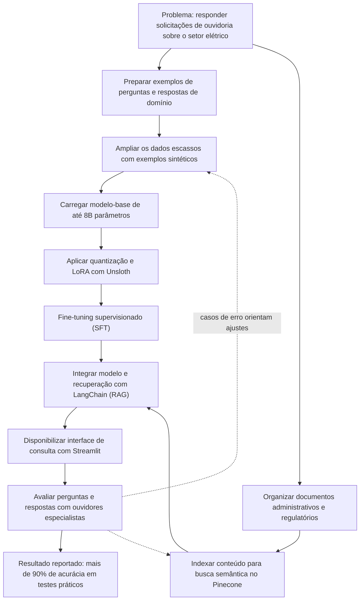

# Agente Especialista no Setor Elétrico — ANEEL

Projeto de IA generativa para apoiar respostas a solicitações de ouvidoria (SOs) relacionadas ao setor elétrico. A solução combina um modelo de linguagem ajustado para o domínio da ANEEL com uma arquitetura RAG (*Retrieval-Augmented Generation*), que consulta materiais administrativos e documentos regulatórios para fornecer contexto às respostas.

> **Resultado reportado:** mais de 90% de acurácia em testes práticos de perguntas e respostas de ouvidoria, realizados por ouvidores especialistas da ANEEL. O projeto não publica o protocolo detalhado, o tamanho da amostra ou a definição operacional da métrica; portanto, esse resultado deve ser entendido como a avaliação prática reportada, não como benchmark independente.

## O problema e a solução

Responder a dúvidas sobre regras do setor elétrico exige linguagem formal, conhecimento especializado e atenção a normas que podem mudar. Um modelo genérico pode produzir respostas pouco específicas ou sem fundamentação suficiente.

O projeto tratou esses pontos em duas frentes:

1. **Adaptação de domínio:** fine-tuning supervisionado (SFT) de um LLM com exemplos de perguntas e respostas sobre o setor elétrico, para aproximar o estilo e o vocabulário das respostas esperadas.
2. **Recuperação de conhecimento:** integração com RAG para buscar documentos pertinentes e fornecer contexto atualizado ao modelo no momento da consulta.

Em linhas gerais, a aplicação recebe a pergunta, recupera trechos relevantes na base vetorial e os utiliza como contexto para gerar uma resposta especializada. O RAG complementa o conhecimento aprendido no fine-tuning; não elimina a possibilidade de erros e não substitui a validação de informações regulatórias.

## Arquitetura e stack

| Tecnologia | Papel no projeto | Justificativa |
|---|---|---|
| **Unsloth** | Carregamento, fine-tuning e inferência do modelo | Permite ajustar LLMs com menor consumo de recursos e acelerar a experimentação. Foi usado com LoRA e quantização para adaptar o modelo ao estilo formal de resposta da ANEEL sem retreinar todos os parâmetros. |
| **Hugging Face** | Modelos e datasets | Hospeda os artefatos públicos associados ao projeto e permite carregar o adaptador treinado para inferência. |
| **LangChain** | Orquestração do RAG | Integra as etapas de busca semântica e geração, conectando a recuperação de contexto ao fluxo de consulta do agente. |
| **Pinecone** | Banco vetorial gerenciado | Fornece busca semântica escalável para localizar documentos relevantes; sua operação em nuvem também permite incorporar controles de acesso e segurança à solução. |
| **Streamlit** | Interface da aplicação | Facilita a criação e a disponibilização de uma interface acessível para testar o agente e conectar a experiência do usuário ao fluxo de IA. |

### Fluxo de desenvolvimento

O diagrama resume as etapas de construção do agente, desde a preparação dos dados até a avaliação prática:



### Fluxo de consulta

```text
Pergunta do usuário
        ↓
Busca semântica de documentos no Pinecone
        ↓
Contexto recuperado + pergunta
        ↓
Geração pelo modelo ajustado
        ↓
Resposta especializada
```

## Fine-tuning e experimentação

Os notebooks públicos documentam o fluxo de preparação de dados, ajuste e inferência. No experimento registrado em **Fine-Tuning com Unsloth**, foram utilizados:

- **Modelo-base:** Llama 3 8B em formato quantizado de 4 bits.
- **Técnica de ajuste:** LoRA, treinando parâmetros adaptadores em vez de todos os pesos do modelo.
- **Dados:** dataset supervisionado de perguntas e respostas sobre MMGD, formatado em instrução, contexto e resposta.
- **Configuração registrada:** comprimento máximo de sequência de 2.048 tokens, batch por dispositivo de 2, acumulação de gradiente de 4 e 60 passos de treino.
- **Execução registrada no notebook:** 97 exemplos e 41.943.040 parâmetros treináveis.

A quantidade limitada de dados de treino foi um dos desafios do projeto. Para ampliar a cobertura de exemplos, foi utilizada geração sintética de dados, além da organização de dados de domínio. Os experimentos com quantização de 4 e 5 bits permitiram trabalhar com modelos de até 8B parâmetros sob restrições de recursos locais. A configuração concreta documentada no notebook usa 4 bits.

O fine-tuning melhora a adaptação de domínio e o formato das respostas, mas não é suficiente para garantir que informações regulatórias estejam atualizadas ou fundamentadas. A integração com RAG foi adotada para recuperar esse conhecimento no momento da consulta e reduzir respostas pobres ou desconectadas das fontes.

## Resultados e desafios

- **Experimentação:** foram treinados e avaliados mais de 15 modelos com 3 datasets diferentes (disponíveis no HuggingFace).
- **Resultado reportado:** acurácia superior a 90% em avaliação prática de perguntas e respostas de ouvidoria, conduzida por ouvidores especialistas da ANEEL.
- **Dados escassos:** uso de geração sintética para aumentar a variedade de exemplos disponíveis ao treinamento.
- **Limite de recursos:** experimentação com quantização e LoRA para viabilizar o ajuste de modelos de até 8B parâmetros em hardware limitado.
- **Qualidade e fundamentação:** integração de RAG para fornecer contexto documental às respostas, complementando o conhecimento paramétrico do LLM.
- **Comunicação interdisciplinar:** elaboração de um guia de fundamentos de NLP para nivelar conceitos entre os participantes do projeto.

## Materiais públicos

Este repositório reúne notebooks e materiais de autoria própria para demonstrar o processo de experimentação. **A aplicação funcional e seu código-fonte são privados**; os notebooks não incluem o produto completo, sua configuração de implantação ou credenciais dos serviços.

- [Fine-tuning com Unsloth](<./Fine-Tuning com Unsloth.ipynb>): carregamento do modelo-base, preparação do dataset, configuração do SFT e teste de inferência.
- [Notebook de inferência no Colab](<./Notebook de Inferência Colab.ipynb>): carregamento do adaptador publicado no Hugging Face e geração de respostas.
- [Guia Fundamental de NLP — ANEEL](<./Guia Fundamental de NLP - ANEEL.ipynb>): material introdutório de IA, redes neurais e processamento de linguagem natural preparado para o projeto.
- [Modelos e perfil no Hugging Face](https://huggingface.co/gustavomacedo): inclui o modelo de inferência `gustavomacedo/Especialista_MMGD_LORA`.
- [Repositório público de notebooks](https://github.com/Gustavo-Macedo1/FineTuning-Agente-Especialista-ANEEL).

## Como explorar

1. Abra os notebooks no GitHub ou no Google Colab e percorra as células na ordem apresentada.
2. No notebook de fine-tuning, confira a preparação do dataset e os parâmetros de treino registrados. O treinamento requer ambiente compatível com GPU e as dependências instaladas no próprio notebook.
3. Para testar inferência, use o notebook de Colab, que carrega `gustavomacedo/Especialista_MMGD_LORA` e envia uma pergunta ao modelo.
4. Consulte o guia de NLP para o contexto conceitual que acompanhou o desenvolvimento.

O notebook de inferência demonstra o modelo ajustado, não a aplicação RAG completa: a base vetorial e a interface Streamlit fazem parte da solução privada.

## Tecnologias

`Python` · `Unsloth` · `LoRA` · `LLMs` · `RAG` · `LangChain` · `Pinecone` · `Streamlit` · `Hugging Face` · `Google Colab`
