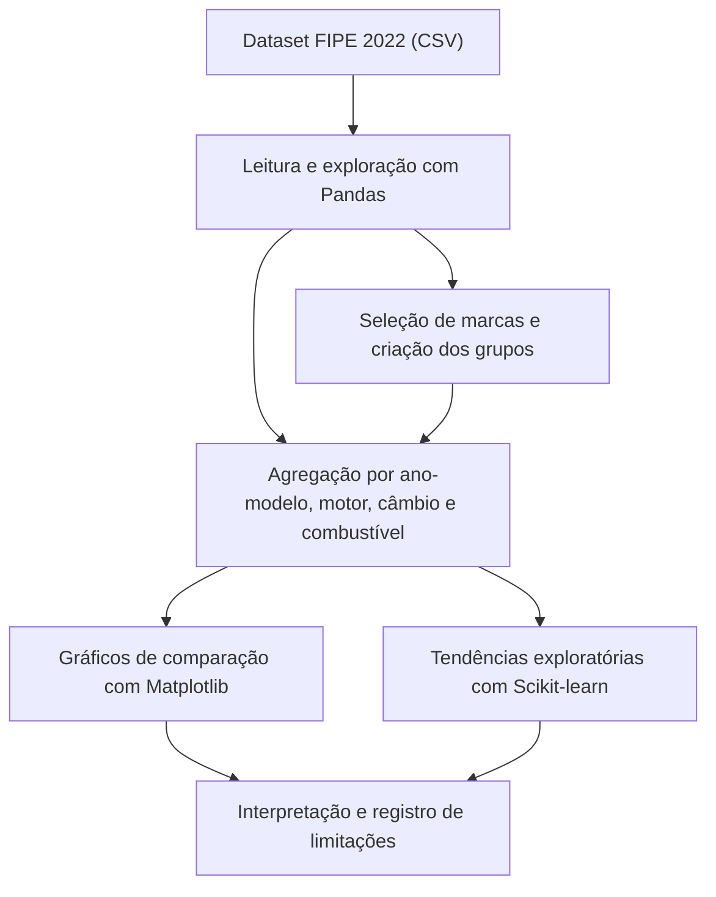

# Análise de Dados Automotivos — FIPE 2022

Projeto de análise exploratória dos preços médios de veículos da Tabela FIPE, usando o recorte de referência de 2022. O objetivo é investigar como ano-modelo, motorização, câmbio, combustível e segmento de marca se relacionam com o preço médio dos veículos no Brasil.

> **Nota sobre o escopo:** apesar do nome do projeto, o notebook disponível analisa dados da Tabela FIPE obtidos no Kaggle — não anúncios ou transações do OLX. Portanto, os resultados descrevem preços de referência da FIPE e não preços efetivamente negociados.

## Perguntas investigadas

- Como o tamanho médio do motor varia por ano-modelo?
- Como o preço médio FIPE varia por ano-modelo e motorização?
- Como se comparam as tendências de preços entre veículos manuais e automáticos?
- Como se comportam os preços de veículos de marcas de luxo e populares?
- Como variam os preços por tipo de combustível nesses grupos?

O estudo parte de hipóteses sobre tendências de motorização e preço, e compara os resultados por grupos. Trata-se de uma análise descritiva e exploratória, não de uma avaliação causal.

## Dados e abordagem

- **Fonte:** Tabela FIPE, dataset obtido no Kaggle.
- **Referência:** ano de 2022.
- **Volume informado no notebook:** 290.275 registros.
- **Variáveis usadas:** marca, modelo, combustível, câmbio, tamanho do motor, ano-modelo e preço médio em reais.
- **Preparação:** leitura dos dados com Pandas, exploração das marcas e agregação de preço e motorização por ano-modelo e categoria.
- **Análise:** visualizações de tendências e regressões lineares com Scikit-learn; também foi testada uma regressão polinomial de grau 3 para representar a tendência de preço.

### Comparação entre segmentos

O notebook explora 86 marcas e define grupos de 10 marcas de luxo e 10 marcas populares para algumas comparações. A seleção é feita por uma heurística baseada na contagem de registros e na razão entre o preço médio da marca e sua contagem de registros. Essa regra é específica do estudo, não uma classificação oficial. Os grupos resultantes contêm **21.762 registros de marcas de luxo** e **155.618 de marcas populares**.

Uma observação importante do próprio estudo é que as distribuições de preço desses segmentos são bastante diferentes. Por isso, as marcas de luxo são tratadas separadamente das populares, em vez de misturar os grupos em uma única média.

## Fluxo da análise

## Resultados observados

- A análise cobre **290.275 registros** e explora **86 marcas**.
- As comparações por segmento usam **10 marcas em cada grupo**, com volumes diferentes: 21.762 registros de luxo e 155.618 populares.
- O notebook conclui que marcas de luxo e populares apresentam comportamentos de preço distintos e devem ser analisadas separadamente.
- Foram construídos gráficos e tendências para apoiar a investigação de preço e motorização por ano-modelo, câmbio e combustível.

Os valores e tendências são descritivos do recorte analisado. Embora o notebook calcule extrapolações para anos futuros usando regressão, não há validação em conjunto de teste nem métricas de erro reportadas. Essas extrapolações não devem ser interpretadas como previsões confiáveis de mercado.

## Stack e justificativa

| Tecnologia | Uso no projeto | Justificativa |
|---|---|---|
| **Python** | Linguagem da análise | Ecossistema consolidado para exploração, manipulação e modelagem de dados. |
| **Pandas** | Leitura do CSV, filtros, agrupamentos e estatísticas descritivas | Simplifica o trabalho com dados tabulares e a segmentação por atributos dos veículos. |
| **NumPy** | Arrays e operações numéricas | Apoia a preparação dos dados para regressão e cálculos de tendências. |
| **Scikit-learn** | Regressão linear e transformação polinomial | Permite testar tendências de forma simples e reproduzível; neste projeto, é usado para exploração, não para um modelo preditivo validado para produção. |
| **Matplotlib** | Gráficos de séries e comparações | Torna as diferenças entre segmentos e categorias mais fáceis de inspecionar e comunicar. |

## Automação e reprodutibilidade

O notebook organiza em código as etapas de leitura, segmentação, agregação, ajuste das regressões e geração dos gráficos. Isso torna a análise reproduzível quando executada com o CSV de entrada. O repositório não demonstra scraping de anúncios, atualização automática dos dados, pipeline agendado, aplicação web ou implantação de modelo.

## Limitações e cuidados de interpretação

- O CSV `fipe_2022.csv`, esperado pelo notebook, não está incluído neste diretório; é necessário obtê-lo da fonte original no Kaggle antes de executar a análise.
- O recorte é da FIPE em 2022 e não acompanha preços de transações reais ao longo do tempo. Comparar anos-modelo em um único recorte não equivale a medir a depreciação histórica de um mesmo veículo.
- A divisão entre marcas de luxo e populares usa uma heurística definida no notebook; não é uma classificação oficial nem uma amostragem balanceada. Os tamanhos dos grupos diferem substancialmente.
- As regressões são exploratórias. Sem validação, métricas de erro, análise de resíduos e controle de variáveis externas, não sustentam conclusões de causalidade nem previsões de mercado.

Esses limites orientam a leitura dos resultados e indicam próximos passos para uma análise mais robusta: documentar a origem exata do dataset, revisar a regra de segmentação, avaliar a qualidade dos dados e validar modelos em observações não usadas no ajuste.

## Como executar

1. Abra [`FIPE.ipynb`](./FIPE.ipynb) em Jupyter ou Google Colab.
2. Obtenha o CSV `fipe_2022.csv` na fonte original do dataset no Kaggle e coloque-o no diretório esperado pelo notebook.
3. Execute as células na ordem apresentada para reproduzir as explorações, regressões e visualizações.

## Materiais do projeto

- [Notebook de análise FIPE 2022](./FIPE.ipynb)
- [Artigo do projeto](<./Artigo 2 - Gustavo de Oliveira Macedo.pdf>)

## Competências demonstradas

`Análise Exploratória de Dados` · `Pandas` · `NumPy` · `Scikit-learn` · `Regressão Linear` · `Engenharia de atributos` · `Visualização de dados` · `Interpretação crítica de modelos`