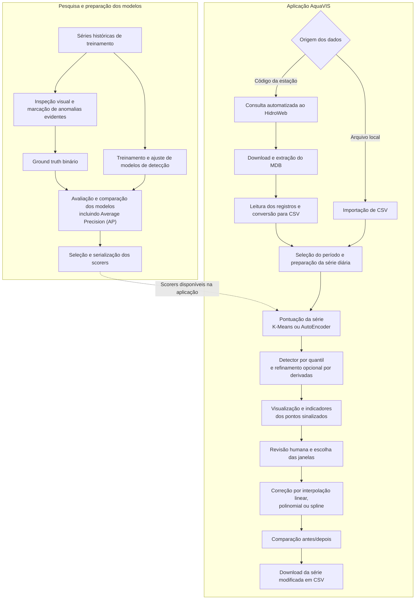

# AquaVIS

**Detecção e correção assistida de anomalias em séries temporais hidrológicas**

O AquaVIS é uma aplicação em Python para analisar séries diárias de cotas de rios da bacia amazônica. O projeto combina modelos de detecção de anomalias, visualização interativa e métodos de interpolação para apoiar um trabalho que, sem automação, exige inspeção manual de dados.

Desenvolvido como projeto de iniciação tecnológica na Universidade de Brasília, o AquaVIS transforma esse fluxo em uma experiência reproduzível: importar ou buscar dados de uma estação, investigar anomalias, revisar as sinalizações, corrigir os pontos selecionados e exportar a série resultante.

> **Automação com supervisão humana:** os modelos sinalizam possíveis anomalias; a pessoa usuária escolhe o modelo e o método de correção, revisa as janelas e confirma as alterações. A aplicação não substitui a validação hidrológica.

## Por que este projeto importa

Valores discrepantes podem distorcer análises de séries hidrológicas. O AquaVIS foi criado para reduzir o esforço braçal de identificar e tratar esses pontos, reunindo em uma interface as etapas de análise, detecção e correção.

O fluxo de aquisição também pode automatizar a consulta de uma estação no HidroWeb da Agência Nacional de Águas e Saneamento Básico (ANA), converter o arquivo MDB baixado em CSV e encaminhar os dados para análise. Como alternativa, é possível carregar um CSV local.

## Funcionalidades

- Busca de dados de uma estação pelo código, com navegação automatizada no HidroWeb.
- Importação de séries em CSV.
- Seleção de intervalo de datas e visualização da série, registros, dados faltantes e cota média.
- Detecção com dois scorers disponíveis na aplicação: **K-Means Scorer** e **PyOD AutoEncoder**.
- Ajuste do quantil usado pelo detector e opção de refinamento baseado em derivadas.
- Comparação visual da série original com os pontos sinalizados e indicadores da execução.
- Revisão e correção em janelas mensais, anuais ou definidas manualmente.
- Correção por interpolação linear, polinomial ou por spline.
- Comparação entre série original e modificada e exportação do resultado em CSV.

O fluxo permite ainda reclassificar manualmente pontos entre normais e anômalos, mantendo a pessoa usuária no controle das decisões.

## Fluxo do projeto

O diagrama reúne a preparação e avaliação dos modelos (offline) com o uso da aplicação. A avaliação científica usou ground truth construído por inspeção visual das anomalias evidentes; no uso interativo, a pessoa usuária revisa os resultados antes de aplicar correções.



## Como funciona

1. **Entrada:** informe o código de uma estação para buscar seus dados no HidroWeb ou carregue um CSV. A série deve conter as colunas `EstacaoCodigo`, `Data` e `Media`.
2. **Exploração:** selecione o período e confira a visualização e os indicadores básicos da série.
3. **Detecção:** a aplicação carrega os scorers serializados em `models/`, calcula pontuações sobre janelas temporais e aplica um detector por quantil. O quantil é configurável; o controle da interface inicia em `0.85`.
4. **Revisão:** escolha K-Means Scorer ou AutoEncoder, avalie os gráficos e os indicadores de anomalias e, se necessário, habilite o refinamento por derivadas.
5. **Correção:** percorra os períodos com pontos sinalizados, escolha um método de interpolação e aplique a correção após revisar a prévia. Também é possível alterar manualmente a classificação de pontos.
6. **Resultado:** compare as séries original e modificada e baixe o CSV.

### Modelos e configuração

O código de treinamento em `modules/models.py` configura o K-Means Scorer com `k=8` e janela de 25 observações. Para o AutoEncoder do PyOD, configura 20 épocas, lote de 32, taxa de aprendizagem `0.0001` e janela de 13 observações. Na interface, o quantil do detector pode ser ajustado para cada execução.

Embora AutoEncoders Variacionais (VAEs) façam parte do contexto de pesquisa do projeto, a aplicação presente neste repositório carrega um **AutoEncoder** do PyOD e um **K-Means Scorer** do Darts. Não se deve confundir o modelo usado nesta versão da aplicação com todos os modelos estudados ao longo da pesquisa.

## Stack e escolhas técnicas

| Tecnologia | Papel no projeto | Justificativa |
|---|---|---|
| **Python** | Linguagem da aplicação e dos experimentos | Integra bibliotecas de séries temporais, aprendizado de máquina, dados e interface no mesmo ambiente. |
| **PyOD** | Modelo de detecção AutoEncoder | Disponibiliza detectores de anomalias e uma API dedicada ao problema, permitindo testar e ajustar abordagens sem implementar o algoritmo do zero. |
| **Darts** | Séries temporais e scorers de anomalia | Oferece abstrações para séries temporais e integra scorers como K-Means e adaptadores para modelos PyOD, facilitando o processamento por janelas. A documentação estruturada também apoiou o estudo dos modelos. |
| **Streamlit** | Interface web | Conecta diretamente a interface ao código Python local, permitindo prototipar rapidamente a experiência, os controles de análise e a visualização sem manter uma aplicação front-end separada. |
| **Pandas / SciPy** | Preparação dos dados e interpolação | Suportam agregação, manipulação de datas e métodos de interpolação usados na preparação e correção das séries. |
| **Plotly** | Gráficos interativos | Permite inspecionar a série, comparar sinalizações e visualizar correções. |
| **Selenium** | Automação de consulta no HidroWeb | Automatiza a navegação e a busca por estação no fluxo de obtenção de dados. |
| **pyodbc** | Leitura dos arquivos MDB | Permite consultar as tabelas de cotas dos arquivos baixados usando o driver ODBC do Microsoft Access. |
| **PyTorch / Joblib** | Execução e persistência de modelos | PyTorch dá suporte ao AutoEncoder; Joblib carrega os scorers serializados usados pela aplicação. |

## Desafios técnicos e abordagem

### Entender modelos complexos

Usar um modelo pronto não elimina a necessidade de entender seu comportamento. O estudo de AutoEncoders e modelos baseados em janelas foi importante para ajustar hiperparâmetros, interpretar pontuações e diagnosticar resultados. O projeto comparou abordagens em vez de tratar uma única configuração como universal.

### Criar um ground truth útil

Séries hidrológicas reais não oferecem necessariamente rótulos prontos para avaliação. A estratégia foi identificar visualmente anomalias evidentes e construir uma série binária de referência para os testes. Esse processo é trabalhoso e depende de julgamento, mas torna possível comparar as sinalizações dos modelos com uma referência explícita.

### Equilibrar sensibilidade e contexto

Um valor extremo pode representar tanto erro de medição quanto um evento hidrológico real. Por isso, o AquaVIS expõe o quantil, oferece comparação entre scorers e inclui revisão humana antes da correção. O refinamento opcional por derivadas é uma etapa adicional de análise, não uma garantia de que todo ponto sinalizado seja incorreto.

## Resultados e evidências

- **Aplicação funcional:** fluxo interativo para busca/importação, análise, detecção, correção assistida e exportação, com potencial de reduzir etapas manuais do tratamento de séries.
- **Indicadores observáveis:** a aplicação apresenta contagem de registros, dados faltantes, cota média, quantidade de pontos sinalizados, anomalias extremas e desvio padrão dos valores sinalizados. Esses indicadores são calculados para a série e a configuração selecionadas.
- **Avaliação científica:** os estudos compararam modelos com **Average Precision (AP)** e utilizaram ground truth construído para os testes. O desempenho depende do conjunto de dados e dos parâmetros; este README não atribui uma pontuação única à aplicação.
- **Produção acadêmica:** dois artigos científicos publicados, além do trabalho completo relacionado ao projeto.
- **Reconhecimento:** menção honrosa na mostra anual de projetos científicos e tecnológicos da Universidade de Brasília, em avaliação por pares.

### Publicações e documentação

- [Artigo: IA na Identificação de Anomalias](docs/Artigo%20-%20IA%20na%20Identifica%C3%A7%C3%A3o%20de%20Anomalias.pdf)
- [Artigo PIBITI](docs/Artigo%20PIBITI%201.pdf)
- [Trabalho completo](<docs/Trabalho_Completo_Gustavo de Oliveira Macedo_NI (1).pdf>)

## Executar localmente

O ambiente do projeto usa Python 3.11. No Windows, a partir da raiz do repositório:

```powershell
py -3.11 -m venv .venv
.\.venv\Scripts\Activate.ps1
python -m pip install --upgrade pip
pip install -r requirements.txt
streamlit run app.py
```

Abra o endereço local exibido pelo Streamlit no terminal.

### Requisitos para buscar uma estação

- Google Chrome instalado e acesso à internet para a navegação automatizada no HidroWeb.
- Driver ODBC do Microsoft Access compatível com a instalação do Python para consultar os arquivos MDB.

Esses requisitos adicionais se aplicam ao fluxo de busca/extração de estação. Para analisar um CSV local, prepare o arquivo com as colunas `EstacaoCodigo`, `Data` e `Media`.

## Estrutura do repositório

```text
.
├── app.py                         # Página inicial e entrada de dados
├── pages/
│   ├── analysis.py                # Exploração da série
│   ├── stage1.py                  # Detecção de anomalias
│   ├── stage2.py                  # Revisão e correção
│   └── stage3.py                  # Comparação e exportação
├── modules/
│   ├── models.py                  # Preparação, scorers e treinamento
│   ├── stations.py                # Consulta HidroWeb e leitura de MDB
│   ├── funcional.py               # Estado e controles da interface
│   └── visual.py                  # Gráficos
├── models/                        # Scorers serializados usados pela aplicação
├── data/                          # Dados de treinamento e exemplos locais
├── docs/                           # Artigos e trabalho completo
└── requirements.txt
```

## Relação com vagas em GenAI

O AquaVIS é um projeto de **aprendizado de máquina aplicado à detecção de anomalias**; a aplicação não usa LLMs nem gera conteúdo. Essa distinção é intencional. O trabalho demonstra competências transferíveis para sistemas de GenAI: preparação e validação de dados, comparação de modelos, ajuste de hiperparâmetros, avaliação com referência, instrumentação de resultados, integração em uma aplicação e desenho de revisão humana para decisões sensíveis.
