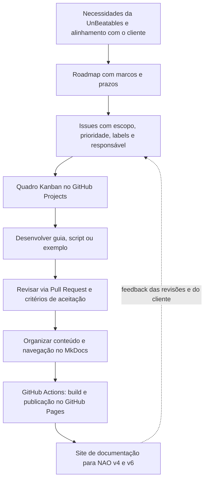

# RoboConnection — documentação e ferramentas para robôs NAO

O **RoboConnection** é um projeto de engenharia de software desenvolvido em 2023 na Residência em TIC da BRISA, em parceria com a UnB, a Softex e o MCTI. A equipe criou um portal de documentação e ferramentas de apoio para a **UnBeatables**, equipe da Universidade de Brasília que desenvolve robôs humanoides NAO para competições de futebol.

O resultado é um site estático desenvolvido com **MkDocs**, com guias separados para as gerações **NAO v4** e **NAO v6**, documentação de ferramentas do ecossistema e scripts para automatizar instalações e configurações. A proposta foi reduzir o tempo gasto por novos integrantes para preparar ambientes legados e começar a programar os robôs.

> **Contribuição pessoal:** Gustavo Macedo atuou como Scrum Master e contribuiu com documentação, organização do site e resolução de issues. As contribuições públicas aparecem no GitHub com o usuário [Gustavo-Macedo1](https://github.com/Gustavo-Macedo1).

## Acessar o projeto

- **Portal publicado:** [RoboConnection — GitHub Pages](https://residenciaticbrisa.github.io/03_Robotica/)
- **Repositório:** [ResidenciaTICBrisa/03_Robotica](https://github.com/ResidenciaTICBrisa/03_Robotica)
- **Issues:** [backlog e solicitações](https://github.com/ResidenciaTICBrisa/03_Robotica/issues)
- **Pull requests:** [revisões e entregas](https://github.com/ResidenciaTICBrisa/03_Robotica/pulls)

## O problema atendido

Os robôs NAO v4 e v6 dependem de versões específicas de sistemas operacionais, SDKs e ferramentas. A documentação original e o processo de instalação podem ser difíceis de seguir; algumas dependências são antigas, instaladores apresentam problemas e ambientes diferentes podem exigir configurações incompatíveis. Isso criava uma barreira de entrada para novos integrantes da equipe.

O RoboConnection organiza o conhecimento em tutoriais passo a passo, diferencia as instruções por versão do robô e complementa a documentação com scripts, exemplos de código e ambientes virtuais. Assim, um integrante pode consultar um caminho de configuração apropriado para o modelo de NAO que pretende usar.

## O que foi entregue

- **Trilhas para NAO v4 e v6:** versões de NAOqi, Choregraphe e SDK C++ documentadas separadamente.
- **Configuração de ambientes:** instruções e scripts para máquinas virtuais baseadas em Ubuntu 14.04 (NAO v4) e Ubuntu 16.04 (NAO v6), além de orientações para conectar o ambiente ao robô ou simulador.
- **Ferramentas de robótica:** guias de Choregraphe, NAOqi, Robot Settings, ROS 1 e ROS 2.
- **Aprendizado de programação:** conceitos gerais, introdução à orientação a objetos com C++ e exemplos C++ para NAOqi 2.1, incluindo um Hello World testado no robô conforme a release do projeto.
- **Automação de setup:** scripts de shell para instalação e compilação de ferramentas e dependências, reduzindo passos manuais repetitivos.
- **Portal navegável e pesquisável:** documentação em Markdown agrupada por objetivo e versão do robô, publicada como site.

## Fluxo de desenvolvimento



### Organização do repositório

```text
03_Robotica/
├── .github/           # templates de issues, pull requests e releases; workflow de deploy
├── docs/              # conteúdo do portal, navegação, imagens e exemplos
├── nao-programs/      # exemplos C++ para NAOqi 2.1
├── scripts/           # automação ROS 1/ROS 2 e ambientes virtuais NAO v4/v6
├── mkdocs.yml         # tema, extensões, busca e navegação do site
└── LICENCE            # licença MIT
```

Dentro de `docs/`, os guias são organizados por assunto e por geração do robô. Essa separação evita misturar instruções incompatíveis entre os ambientes v4 e v6 e torna mais simples localizar o procedimento correto.

## Processo de engenharia e colaboração

O trabalho foi organizado para manter alinhamento com a equipe, os gestores e o cliente sem adicionar cerimônias diárias que o grupo não considerava necessárias:

- **Reuniões semanais da equipe** para alinhar progresso, dependências e prioridades; optamos por não fazer *dailies*.
- **Revisões quinzenais com os gestores** para apresentar andamento, validar entregas e ajustar o plano.
- **Reuniões mensais com o cliente** para confirmar necessidades e recolher feedback sobre a documentação.
- **Roadmap com prazos** para dividir a entrega em marcos e acompanhar o que precisava ser concluído.
- **GitHub Projects em Kanban** para visualizar cartões e estados do trabalho, conectando o planejamento às issues.
- **Issues estruturadas** com título e descrição, passos para reproduzir bugs, labels, prioridade, status, responsável e referências cruzadas.
- **Pull requests revisáveis** com descrição da alteração, passos de teste, critérios de aceitação, labels e revisores.

Esse processo tornou o trabalho rastreável: uma necessidade podia ser detalhada em uma issue, priorizada no quadro, implementada em uma branch, revisada por PR e publicada no site. A cadência de revisões ajudava a detectar problemas de instalação e navegação enquanto ainda era possível ajustar o escopo.

## Contribuições de Gustavo no GitHub

O histórico público registra **seis pull requests de autoria de Gustavo**, dos quais **cinco foram integrados**. Exemplos de entregas:

- [PR #48 — adição de instruções e correções](https://github.com/ResidenciaTICBrisa/03_Robotica/pull/48)
- [PR #59 — visão geral do NAOqi](https://github.com/ResidenciaTICBrisa/03_Robotica/pull/59)
- [PR #77 — evolução da página do projeto](https://github.com/ResidenciaTICBrisa/03_Robotica/pull/77)
- [PR #83 — correções na página](https://github.com/ResidenciaTICBrisa/03_Robotica/pull/83)
- [PR #93 — guia de orientação a objetos com C++](https://github.com/ResidenciaTICBrisa/03_Robotica/pull/93)

Entre as issues atribuídas a Gustavo e encerradas estão [Robot Settings para NAO v6 (#6)](https://github.com/ResidenciaTICBrisa/03_Robotica/issues/6), [guia de ROS 1 (#7)](https://github.com/ResidenciaTICBrisa/03_Robotica/issues/7), [NAOqi 2.8 (#8)](https://github.com/ResidenciaTICBrisa/03_Robotica/issues/8), [Choregraphe 2.8 (#13)](https://github.com/ResidenciaTICBrisa/03_Robotica/issues/13), [estudo do SDK C++ (#58)](https://github.com/ResidenciaTICBrisa/03_Robotica/issues/58), [conceitos gerais (#75)](https://github.com/ResidenciaTICBrisa/03_Robotica/issues/75) e [guia de POO com C++ (#92)](https://github.com/ResidenciaTICBrisa/03_Robotica/issues/92).

No momento da consulta, o repositório registrava **66 issues encerradas** no total. Esse número inclui tanto itens concluídos quanto decisões de escopo e itens marcados como *wontfix*; não deve ser interpretado como 66 entregas individuais de Gustavo.

## Stack e justificativas

| Tecnologia | Uso no projeto | Por que foi escolhida |
|---|---|---|
| **Markdown** | Escrita dos guias e tutoriais | Mantém a documentação versionada junto ao código, fácil de revisar em PRs e simples de atualizar. |
| **MkDocs + Material** | Geração do portal estático | Converte Markdown em um site com navegação por seções, busca, abas e suporte a conteúdo visual, sem exigir uma aplicação web própria. |
| **GitHub** | Versionamento, Issues, Projects, PRs e releases | Centraliza código, backlog e decisões; dá rastreabilidade entre solicitação, implementação e entrega. |
| **GitHub Actions + GitHub Pages** | Build e publicação | Automatiza a geração e a publicação do site a cada atualização na branch `main`, reduzindo publicação manual e mantendo o portal alinhado ao repositório. |
| **Shell/Bash** | Instalação e configuração de dependências | Automatiza comandos repetitivos e sensíveis à ordem, reduzindo diferenças entre configurações feitas manualmente. |
| **C++ e qiBuild/CMake** | Exemplos e SDK do NAOqi | Refletem a stack necessária para desenvolver e compilar programas para os robôs, especialmente para o ambiente legado do NAO v4. |
| **Máquinas virtuais Ubuntu** | Ambientes compatíveis com versões distintas do NAOqi | Isolam dependências antigas e permitem trabalhar com os dois modelos sem exigir que todas as versões coexistam no sistema principal. |

### Publicação automatizada

O workflow em `.github/workflows/main.yml` executa em pushes para `main`: faz checkout, configura Python, instala MkDocs e seus plugins, constrói o site e publica no GitHub Pages. Isso fecha o ciclo entre documentação revisada e material acessível aos usuários.

## Resultados e impacto

- **Entrega concluída:** site MkDocs com documentação e caminhos de uso para os NAO v4 e v6, atendendo às necessidades da equipe UnBeatables.
- **Automação:** scripts para setups que antes exigiam várias etapas manuais; o site do projeto relata que novos integrantes podiam levar semanas ou meses para preparar as ferramentas e que agora podem iniciar a instalação executando um script. Esse relato demonstra o impacto esperado, mas não representa um estudo controlado de tempo.
- **Processo rastreável:** roadmap, Kanban, issues priorizadas e PRs revisados conectaram planejamento, desenvolvimento e publicação.
- **Manutenção colaborativa:** conteúdo em Markdown, templates e navegação do MkDocs permitem que futuros integrantes corrijam e ampliem os guias sem depender de um documento monolítico.

## Relação com engenharia de software e GenAI

O RoboConnection é um projeto de documentação e engenharia de software, **não um produto de GenAI**. Sua relevância para uma equipe de GenAI está nos processos que também sustentam sistemas de IA em produção: decompor requisitos, manter rastreabilidade, automatizar ambientes, documentar dependências, revisar mudanças e publicar entregas de forma repetível. Essas práticas reduzem o atrito de onboarding e ajudam a tornar experimentos, ferramentas e serviços de IA mais fáceis de instalar, validar e manter.

## Executar o site localmente

Com Python instalado, na raiz do repositório:

```bash
python -m pip install mkdocs mkdocs-material mkdocs-git-revision-date-localized-plugin
mkdocs serve
```

Para validar a geração estática:

```bash
mkdocs build
```

> **Nota:** os guias tratam de versões legadas de sistemas operacionais e ferramentas de robótica. Antes de usar os procedimentos hoje, confira os requisitos e a disponibilidade dos instaladores nas fontes oficiais.

## Licença

O repositório é distribuído sob a [licença MIT](./LICENCE).
