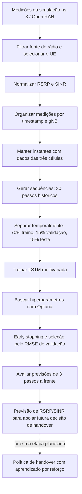

# Previsão de Métricas de Rede 5G com LSTM — Open RAN

Projeto de *machine learning* para prever a qualidade de rádio em uma rede 5G/Open RAN simulada no ns-3. O pipeline transforma medições de RSRP e SINR de múltiplas células em séries temporais e treina uma LSTM para estimar seus valores futuros para um equipamento de usuário (UE).

Essas previsões são uma etapa de pesquisa para apoiar decisões futuras de handover em xApps. **O acionamento automático do handover por aprendizado por reforço ainda é trabalho planejado, não uma funcionalidade implementada neste repositório.** O notebook de pipeline é de autoria própria e faz parte de uma iniciativa nacional mais ampla.

> **Escopo:** este é um projeto de previsão com ML, não uma aplicação de GenAI/LLM. Ele demonstra competências transferíveis para sistemas de IA — preparação de dados, modelagem temporal, otimização, avaliação e análise de falhas — sem reivindicar funcionalidades generativas.

## Problema e objetivo

Em redes móveis, o handover transfere a conexão do UE entre células à medida que ele se desloca, idealmente sem interrupção. Decidir quando e para qual célula transferir envolve condições de rádio e outros fatores de rede. O material de referência [Handover](<./docs/Handover.pdf>) descreve critérios como qualidade de cobertura — incluindo RSRP, RSRQ e SINR —, distância, tipo de serviço e balanceamento de carga.

Este projeto se concentra em prever duas métricas de rádio:

- **RSRP** (*Reference Signal Received Power*): potência recebida do sinal de referência.
- **SINR** (*Signal-to-Interference-plus-Noise Ratio*): relação sinal/interferência mais ruído.

O foco atual é um UE e três células/gNBs. A LSTM prevê as seis séries (RSRP e SINR para cada gNB), fornecendo uma base temporal que poderá ser usada por uma política de handover em uma etapa posterior.

## Como o pipeline funciona

### Dados usados

O arquivo [`rsrp_sinr_triangulado-1.csv`](./data/rsrp_sinr_triangulado-1.csv) contém **84.905 linhas e 7 colunas**:

| Coluna | Conteúdo |
|---|---|
| `time_s` | Timestamp da amostra |
| `RSRP_2`, `SINR_2` | RSRP e SINR da célula/gNB 2 |
| `RSRP_3`, `SINR_3` | RSRP e SINR da célula/gNB 3 |
| `RSRP_4`, `SINR_4` | RSRP e SINR da célula/gNB 4 |

O arquivo não apresenta valores ausentes nas sete colunas. As seis séries de métricas estão normalizadas e, neste arquivo, os valores observados estão entre aproximadamente 0 e 1. O pipeline usa uma janela de **30 passos de entrada** e horizonte de **3 passos futuros**, em um problema de regressão multivariada.

## Modelagem e treinamento

- **Pré-processamento:** o notebook filtra medições `MMWAVE-PHY`, seleciona o UE de IMSI 1, organiza valores por timestamp e gNB e mantém amostras com métricas disponíveis para as três células.
- **Particionamento temporal:** 70% treino, 15% validação e 15% teste, respeitando a ordem dos timestamps.
- **Modelo:** LSTM em PyTorch com uma camada linear de saída para prever conjuntamente as seis métricas.
- **Busca de hiperparâmetros:** Optuna executa até 20 trials e minimiza o RMSE de validação. O espaço inclui tamanho oculto, número de camadas, dropout, weight decay e batch size; são usados sampler TPE e *MedianPruner*.
- **Controle do treinamento:** AdamW, agendador `ReduceLROnPlateau`, acompanhamento do RMSE de validação, restauração dos melhores pesos e *early stopping*.

O notebook também documenta um treinamento final com configuração padrão de 64 unidades ocultas, uma camada, dropout 0,2, learning rate `0.0003`, weight decay `0.0001` e batch size 32. Os hiperparâmetros de outras execuções podem ser diferentes.

## Resultados

A avaliação define **“acurácia” como a proporção de previsões cujo erro relativo é de até 10%**. É uma métrica de tolerância para regressão, não a acurácia de um classificador. Os valores abaixo correspondem a artefatos de execuções distintas:

| Execução registrada | Acurácia (tolerância ±10%) | MAE | MSE | RMSE | MAPE | R² |
|---|---:|---:|---:|---:|---:|---:|
| Saída salva no notebook | 84,97% | 0,021438 | 0,002005 | 0,044776 | 5,16% | 0,8035 |
| [Relatório de Treinamento 15](<./docs/Relatório de Treinamento 15.pdf>) | 83,89% | 0,021406 | 0,001847 | 0,042979 | 5,38% | 0,8189 |

No relatório 15, a acurácia por série varia de **69,19% a 91,18%**: RSRP da célula 2 é o caso mais difícil; SINR da célula 4 é o melhor resultado dessa execução. Essa variação é importante para a aplicação: a média global não representa igualmente a qualidade da previsão em cada célula e métrica.

Os resultados são os números registrados nos artefatos do projeto, não uma garantia de desempenho em outras simulações ou redes reais. MAE, MSE e RMSE estão apresentados na escala numérica usada na execução; como as séries do CSV estão normalizadas, não devem ser interpretados diretamente como erro em dBm ou dB sem confirmar a transformação inversa e o scaler correspondente.

### Reprodutibilidade do notebook

Há dois pontos a resolver antes de reproduzir o treinamento em um kernel limpo:

- A etapa de preparação inicial lê `dataset_lstm.csv`, que não está incluído. O CSV processado está em `data/`.
- Na etapa de treino, as linhas que criariam `scaled` e ajustariam o `scaler` estão comentadas, mas `scaled` é usado para criar as sequências e `scaler` é usado na avaliação para reverter a transformação. É necessário definir uma transformação coerente para as seis métricas — ajustada apenas com os dados de treino — ou manter as séries na escala atual e remover a inversão correspondente. Sem isso, as células de treino/avaliação podem falhar ou calcular métricas numa escala inconsistente.

Assim, os PDFs e as saídas salvas no notebook são evidências de execuções anteriores; eles não garantem que o notebook, exatamente como está no repositório, reproduza os mesmos resultados de ponta a ponta.

## Desafios e decisões de engenharia

- **Instabilidade da perda:** o loss de treino chegou a explodir em experimentos iniciais. Ajustes na organização das séries e no learning rate ajudaram a estabilizar o treinamento.
- **Tempo de execução:** a busca de hiperparâmetros pode exigir muitos ciclos de treino. Early stopping, ajuste de paciência e poda de trials reduzem trabalho em configurações que não melhoram.
- **Overfitting e desempenho inicial baixo:** as primeiras versões ficaram em torno de 50% na métrica de acurácia usada pelo projeto. A evolução da preparação dos dados e do treinamento levou a resultados na faixa de 84%; o histórico do projeto reporta melhora de até 30% frente ao modelo inicial.
- **Dados de simulação:** a inspeção visual das séries indicou cenários em que os valores absolutos de RSRP/SINR variavam sem mudança proporcional na distribuição. Isso motivou cautela ao interpretar os resultados e evidencia que a qualidade e a diversidade dos cenários ns-3 limitam o que o modelo consegue aprender.
- **Previsão por célula:** os resultados desagregados mostram que algumas séries são mais difíceis que outras, orientando análise adicional de features, cenários e critérios de handover em vez de depender apenas da métrica agregada.

## Stack e justificativas

| Tecnologia | Papel | Justificativa |
|---|---|---|
| **Python** | Linguagem do pipeline | Ecossistema prático para análise, modelagem e experimentação reprodutível. |
| **Pandas e NumPy** | Leitura, transformação, agrupamento e janelamento das séries | Simplificam o tratamento tabular e a preparação de tensores de sequências. |
| **Scikit-learn** | Normalização e métricas de regressão | Oferece componentes testados para escalar variáveis e calcular MAE, MSE, RMSE, MAPE e R². |
| **PyTorch** | LSTM, treinamento e inferência | Permite definir e treinar a rede recorrente com controle sobre tensores, gradientes e loop de treino. |
| **Optuna** | Otimização de hiperparâmetros | Automatiza a exploração de espaços delimitados, minimiza RMSE de validação e suporta poda/early stopping para reduzir experimentos improdutivos. |
| **Matplotlib, Seaborn e Plotly** | Inspeção e comunicação dos resultados | Apoiam a análise das séries, curvas de perda, resíduos e comparações entre valores reais e previstos. |

## Como reproduzir

1. Abra [`Pipeline_LSTM_ORAN.ipynb`](./Pipeline_LSTM_ORAN.ipynb) em Jupyter ou Google Colab e instale as dependências indicadas no notebook.
2. Para repetir a preparação desde os dados brutos, disponibilize `dataset_lstm.csv` no diretório esperado pelo notebook. Esse arquivo de entrada não está incluído.
3. Para usar o CSV processado fornecido, comece pela configuração do pipeline de treino (após as células de preparação), ajuste `DATA_PATH` para `./data/rsrp_sinr_triangulado-1.csv` ao executar a partir da pasta `ORAN`, e resolva as inconsistências de scaler descritas acima.
4. Execute o tuning e a avaliação. O notebook usa partições temporais para treino, validação e teste.

Os artefatos documentam execuções e métricas, mas os resultados podem variar com a versão das dependências, a origem dos dados e os hiperparâmetros escolhidos. O notebook e os PDFs são materiais de desenvolvimento; não há neste repositório um serviço de inferência ou acionamento de handover em produção.

## Próximos passos

- Melhorar a cobertura e diversidade dos cenários simulados.
- Avaliar estratégias de previsão por célula e calibração dos erros, especialmente nas séries mais difíceis.
- Integrar as previsões a uma política de aprendizado por reforço para decidir se/quando executar handover.
- Avaliar a política em simulação antes de qualquer consideração de operação real.

## Materiais do projeto

- [Pipeline de preparação e treinamento LSTM](./Pipeline_LSTM_ORAN.ipynb)
- [CSV processado de RSRP/SINR](./data/rsrp_sinr_triangulado-1.csv)
- [Documento de referência sobre handover](<./docs/Handover.pdf>)
- [Relatório de Treinamento 15](<./docs/Relatório de Treinamento 15.pdf>)
