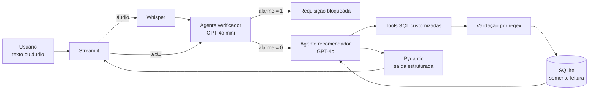

# Sistema Multiagente de Recomendação de Refeições

Aplicação de IA generativa que transforma um pedido em linguagem natural em recomendações de refeições consultadas em um banco relacional. O projeto combina dois agentes especializados, saída estruturada e uma interface que torna o fluxo de execução observável.  

> Projeto de portfólio inspirado no domínio e na estrutura de dados do iFood. Os estabelecimentos, itens e avaliações usados na demonstração são fictícios e ficam em uma base SQLite local; a aplicação não representa uma integração oficial nem consulta à API do iFood em tempo real.

## Visão geral

O usuário descreve o que deseja comer — por exemplo, “quero um hambúrguer de carne sem lactose” — e o sistema:

1. avalia o pedido em busca de prompt injection, SQL injection ou conteúdo fora do escopo;
2. encerra o fluxo caso encontre risco;
3. caso o pedido seja aprovado, converte suas preferências em consultas SQL;
4. consulta apenas itens disponíveis e relaciona cardápio, estabelecimento e avaliações;
5. devolve uma lista tipada contendo item, estabelecimento, preço, avaliação e justificativa.

O sistema leva em conta os seguintes critérios para recomendação:

    - Proximidade com o usuário;
    - Descrição do item;
    - Restrições dietéticas;
    - Preço do item;
    - Avaliação do item;
    - Avaliação do merchant.

A interface também aceita entrada por áudio e utiliza Whisper para transcrição antes de encaminhar o pedido ao fluxo de agentes.

## Arquitetura e fluxo



O `LangGraph` mantém o estado compartilhado e controla a aresta condicional entre os agentes:

```text
START → verificador → [seguro?] → recomendador → END
                         └─ não ───────────────→ END
```

### Agente verificador

É a primeira barreira do fluxo. Ele classifica a entrada com o schema `RespostaVerificador`, composto por um alarme e sua justificativa. Somente prompts aprovados chegam ao agente que possui acesso às ferramentas do banco.

### Agente recomendador

Interpreta intenção, preferências e restrições alimentares. Em seguida, usa três ferramentas próprias para listar tabelas, inspecionar schemas e executar consultas. Seu prompt orienta a construção de `JOINs`, o filtro de disponibilidade, a agregação de avaliações e a eliminação de recomendações duplicadas.

A resposta final segue o schema `Recomendacao`, uma lista de `ItemRecomendado` com:

- nome do item e do estabelecimento;
- preço e avaliação média;
- justificativa contextual para a sugestão.

### Camadas de segurança

O acesso a SQL foi tratado como uma operação sensível e adota defesa em profundidade:

- agente verificador antes do agente com tools;
- tool SQL própria, em vez da execução genérica oferecida pelo toolkit;
- allowlist de consultas iniciadas por `SELECT` ou `WITH`;
- bloqueio por regex de comandos de escrita e de definição de dados;
- conexão SQLite aberta em modo `read-only`;
- limite de recursão para reduzir loops de chamadas do agente.

Essas medidas demonstram uma abordagem de redução de risco, mas não substituem controles de produção como parser/AST SQL, autorização por usuário, isolamento de infraestrutura, limites de custo e tempo, auditoria e testes adversariais contínuos.

## Modelo de dados

A base de demonstração reproduz entidades comuns a uma plataforma de delivery:

| Tabela | Responsabilidade |
| --- | --- |
| `merchant` | Estabelecimentos, status e distância |
| `item` | Refeições, descrição, preço, disponibilidade e restrições alimentares |
| `catalog` | Relação muitos-para-muitos entre estabelecimentos e itens |
| `merchant_review` | Notas e comentários associados aos estabelecimentos |

O script de seed inclui opções tradicionais, vegetarianas, veganas, sem glúten e zero lactose, permitindo testar diferentes intenções e restrições.

## Stack e decisões técnicas

| Tecnologia | Papel e justificativa |
| --- | --- |
| **Python** | Ecossistema principal da aplicação, dos agentes e da camada de dados. |
| **SQLite + SQLAlchemy + SQLDatabase** | SQLite foi escolhido pela simplicidade operacional, portabilidade e ausência de infraestrutura externa. A integração direta com Python por `sqlite3`, SQLAlchemy e `SQLDatabase` permitiu concentrar o projeto no raciocínio dos agentes. Para uma prova de conceito, oferece um bom equilíbrio entre fidelidade relacional e baixo custo de configuração. |
| **LangChain** | Eu já possuía experiência com CrewAI e usei o projeto para aprender outra abordagem de construção de agentes, incluindo tools, prompts e respostas estruturadas. |
| **LangGraph** | Foi a evolução natural da escolha anterior: explicita nós, estado, transições e interrupções, facilitando a orquestração dos dois agentes e a futura expansão do fluxo. |
| **Pydantic** | Adiciona validação de tipos e contratos claros às entradas das tools e às respostas dos agentes. Além de ser amplamente adotado no ecossistema Python, torna a saída adequada para integrações posteriores, como uma API FastAPI. |
| **Streamlit** | A ideia inicial era expor apenas endpoints FastAPI, mas uma demonstração limitada ao Swagger teria pouca riqueza visual. Streamlit permite observar aprovação ou bloqueio, andamento da consulta e cards de recomendação em uma única interface, reduzindo o esforço de front-end nesta fase. |
| **OpenAI GPT-4o / GPT-4o mini** | O modelo menor atende à classificação de segurança, enquanto o modelo mais capaz executa o raciocínio de recomendação e uso de tools. Essa separação sugere uma estratégia de custo e capacidade por tarefa. |
| **Whisper** | Oferece uma segunda modalidade de entrada e aproxima a prova de conceito de uma experiência conversacional. |

### Por que modelar o domínio do iFood?

O objetivo foi compreender de forma prática um contexto próximo ao ambiente da empresa-alvo e demonstrar como agentes, dados relacionais e guardrails podem gerar valor em um cenário realista de recomendação. A base local foi inspirada em conceitos de catálogo, merchants, itens e reviews associados ao ecossistema de delivery, sem depender de serviços externos durante a demonstração.

### Por que dedicar um agente à segurança?

Sistemas grandes combinam múltiplos mecanismos de segurança. Separar a triagem em um agente torna a responsabilidade explícita, impede que entradas reprovadas alcancem as tools e permite evoluir essa etapa de forma independente. A validação determinística da query e o banco somente leitura complementam o classificador probabilístico.

## Como executar

### Pré-requisitos

- Python 3.10 ou superior;
- uma chave da API da OpenAI.

Clone o repositório, acesse sua pasta e crie um ambiente virtual:

```bash
python -m venv .venv
```

No Windows (PowerShell):

```powershell
.\.venv\Scripts\Activate.ps1
pip install -r requirements.txt
```

No Linux ou macOS:

```bash
source .venv/bin/activate
pip install -r requirements.txt
```

Crie um arquivo `.env` na raiz do projeto:

```dotenv
OPENAI_API_KEY=sua_chave_aqui
```

O repositório já contém uma base de demonstração. Para recriá-la a partir do seed, execute:

```bash
python database/criar_database.py
```

> Esse comando repopula a base local e substitui os dados de demonstração existentes.

Inicie a aplicação a partir da raiz do projeto:

```bash
streamlit run main.py
```

Depois, abra o endereço informado pelo Streamlit, normalmente `http://localhost:8501`.

## Exemplos de uso

```text
Quero três opções de hambúrguer de carne.
```

```text
Sou intolerante à lactose. O que posso pedir?
```

```text
Quero uma opção vegana, sem glúten e bem avaliada.
```

```text
Sugira um cachorro-quente por até R$ 25.
```

## Estrutura do projeto

```text
.
├── agents.py                 # schemas, prompts, modelos e tools SQL
├── database_agent.py         # estado, nós e grafo de execução
├── main.py                   # navegação multipágina do Streamlit
├── ifood_dataset.db          # banco SQLite de demonstração
├── database/
│   └── criar_database.py     # criação do schema e seed
├── pages/
│   ├── app.py                # apresentação do projeto
│   ├── run_app.py            # chat e visualização da execução
│   └── tools_log.py          # schema do banco e logs de chamadas das tools
└── assets/                   # imagens da interface
```

## Desafios enfrentados

### Saídas estruturadas com Pydantic

Integrar Pydantic ao LangChain pela primeira vez exigiu entender como o agente devolve `structured_response`, como validar as instâncias e como representar campos opcionais sem quebrar a interface. A solução foi definir contratos específicos para verificação e recomendação e checar explicitamente o tipo retornado em cada nó.

### Orquestração com LangGraph

Nós, estado tipado, arestas condicionais e limites de recursão introduziram uma nova forma de pensar o fluxo. A implementação final mantém cada responsabilidade isolada e deixa visível a decisão crítica: recomendar ou abortar.

### Tools SQL seguras

O toolkit pronto simplificava o acesso ao banco, mas não atendia ao nível de proteção desejado para esta demonstração. Por isso, implementei tools próprias e combinei validação por regex com uma conexão somente leitura. A decisão também tornou mais claro quais capacidades são realmente entregues ao modelo.

### Recomendações pobres ou inconsistentes

As primeiras versões produziam itens duplicados, consultas incompatíveis com o schema e ciclos excessivos de tools. O comportamento foi estabilizado com regras de prompt mais específicas, agregação correta de avaliações, busca em nome e descrição, restrição a itens disponíveis, schemas de resposta e limites de recursão.

## Limitações atuais

- O banco é pequeno, local e fictício; não representa escala, disponibilidade ou diversidade de um catálogo real.
- A classificação de segurança por LLM e regex pode produzir falsos positivos ou negativos.
- Não há memória persistente de conversa nem personalização baseada no histórico do usuário.
- Não há suíte automatizada de avaliação para relevância, segurança, latência e custo.
- A aplicação depende de chamadas externas aos modelos da OpenAI.
- A observabilidade atual está concentrada na interface e nos logs locais, sem tracing ou métricas persistentes.

## Melhorias futuras

- corrigir a codificação da base para evitar caracteres malformados;
- aprimorar a apresentação visual das recomendações;
- evoluir o prompt e o schema para pedidos com quantidades e vários tipos específicos de item;
- adicionar perfil, histórico e feedback do usuário para personalização;
- criar avaliações automatizadas de qualidade e testes de prompt/SQL injection;
- substituir regex isolada por análise sintática de SQL e políticas de autorização mais robustas;
- adicionar tracing, métricas de tokens, latência, erros e taxa de bloqueio;
- estruturar endpoints com FastAPI, separar back-end e front-end e empacotar a solução com Docker;
- migrar para um banco gerenciado e uma arquitetura adequada a concorrência e escala;
- aplicar cache, timeouts, retries e fallback de modelos para maior resiliência.

## Aviso

Este é um projeto educacional e de portfólio, sem vínculo oficial com o iFood. Marcas e nomes citados pertencem aos seus respectivos titulares.
